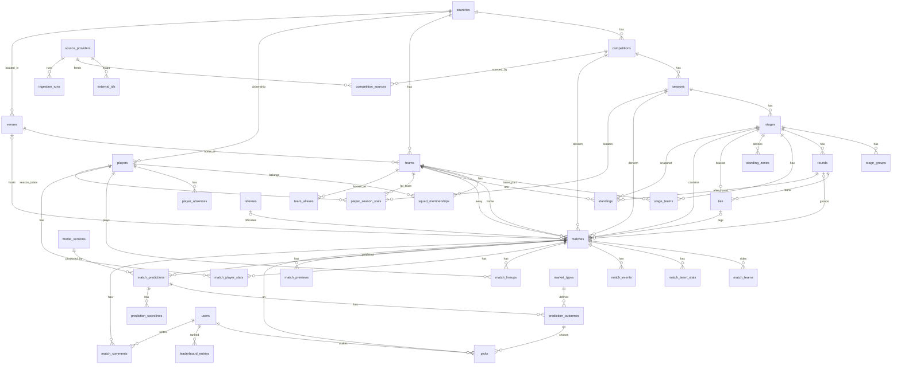

# MatchIQ — схема БД (черновик)

**Статус:** схема согласована; миграции (`web/database/migrations/2026_11_25_*`), Eloquent-модели (`web/app/Models`) и PHP-enum'ы (`web/app/Enums`) созданы 2026-11-25. Для наблюдаемости ingestion добавлены `ingestion_run_errors` и `external_ids.last_ingestion_run_id` (миграция `2026_11_25_100040`). Не создавались таблицы «позже»: `match_comments`, `team_season_stats` (решение № 16 и колонка MVP). Страницы пока на моках.  
**СУБД:** PostgreSQL (источник правды), Redis — кэш/очереди/сессии. Приложение: Laravel 11; сбор данных — исполнитель прогонов (Laravel по умолчанию либо Go collector, [№ 36](open-questions.md)) пишет в те же таблицы через нормализацию.  
**Язык:** текст — русский; имена таблиц и полей — английский `snake_case` (как в коде и как нужно для маппинга источников).

## Документы

| Файл | Что внутри |
|------|-----------|
| [README.md](README.md) | Этот файл: цель, границы MVP, принципы, обзорная ER-диаграмма, что считаем вместо хранения |
| [schema.md](schema.md) | Описание всех таблиц по доменам + ER-диаграмма на каждый домен |
| [formats.md](formats.md) | Форматы соревнований (РПЛ, кубок, стыки, товарищеские, UCL, ЧМ, две группы, чистый плей-офф) → как они раскладываются на `stages` / `rounds` / `ties` |
| [i18n.md](i18n.md) | Мультиязычность сущностей: EN в `name`, переводы в jsonb `name_i18n`; сравнение вариантов, правила записи/чтения |
| [performance.md](performance.md) | Производительность при большом объёме: горячие пути и бюджет запросов, что материализуем и кэшируем, ключевые индексы, партиционирование, что не делаем в MVP |
| [../architecture/](../architecture/README.md) | Слои Laravel-приложения и правила [ingestion](../architecture/ingestion.md): поток парсер/API → upsert, наблюдаемость прогонов, смена источника (рядом со схемой, не её часть) |
| [open-questions.md](open-questions.md) | Принятые решения (defaults приняты) и что пересмотреть после реальных данных |

Исходные требования — [docs/desc_pages/](../desc_pages/README.md) (главная, матч, турнир, клуб, рейтинг, профиль) и корневой [README](../../README.md).

## Цель

Одна нейтральная к источнику доменная модель, на которую садятся все экраны MVP:

- **Главная** — лиги по странам (`status: live | soon`, `sort_order`), матчи дня, мини-таблица и бомбардиры лиги.
- **Матч** (`scheduled / live / finished`) — шапка (судья, стадион, погода), вероятности и рынки, составы, события, статистика по периодам, форма, H2H.
- **Турнир** (`/tournaments/{id}`) — сезон, тур, таблица (все / хозяева / гости), форма, расписание, результаты, лидеры.
- **Клуб** (`/clubs/{id}`) — позиция в таблице, кубок (группы), матчи по соревнованиям, игроки.
- **Рейтинг и профиль** — пользователи, picks (1 событие на матч), очки, окна «неделя / месяц / сезон / всё время».

## Границы MVP

**Входит:** справочники (страны, соревнования, сезоны, этапы, туры, пары плей-офф, клубы, стадионы, игроки, судьи), матчи с событиями, составами и статистикой, таблицы, вероятности модели и рынки, пользователи/picks/рейтинг, маппинг источников.  
**Не входит (позже):** товарищеские матчи и соревнования `friendly` (задел в модели есть, правило picks/рейтинга не зафиксировано), трансферы и договоры игроков, удары с координатами (shot map), live-поток событий в реальном времени (polling/WebSocket), новости, админка, UI-переключатель языка и AI-переводы (колонки `name_i18n` закладываются сразу, см. [i18n.md](i18n.md)), платежи, комментарии с модерацией. В схеме такие таблицы помечены «позже» либо вынесены в [open-questions.md](open-questions.md).

## Принципы

1. **Мульти-лига с первого дня.** Лига/кубок — строка в `competitions`, не ветка кода. Страница матча, таблица и клуб работают одинаково для РПЛ, UCL и любой следующей. Включение лиги = `competitions.status = 'live'` + подключение источника (`competition_sources`), без миграций.
2. **Competition → season → stage → round / tie.** Сезон принадлежит соревнованию (`seasons.competition_id`): у РПЛ «2026/27» (июль–май), у других лиг календарь свой, у ЧМ — «2026». **Формат живёт в этапах сезона** (`stages`), а не в типе соревнования: `league` (круговой, туры), `group` (группы), `knockout` (плей-офф), `playoff` (стыки), `friendly` (товарищеские). Туры — `rounds` (`matchday`) или раунды сетки (`knockout_round`); пары плей-офф — `ties` с `legs = 1` (один матч, ЧМ) или `legs = 2` (первый + ответный, UCL). Так формат может меняться по сезонам без миграций. Каталог рецептов по всем форматам — [formats.md](formats.md). **Сезон рейтинга платформы** (1 авг — 31 июл) — это не `seasons`: он считается в коде по дате (`App\Support\RatingSeason`) и в БД как отдельная сущность не хранится.
3. **Источник сменяем (парсер → платный API).** Внутренние `id` — наши, стабильные, **никогда не равны внешним**. Привязка к внешним системам — таблица `external_ids` (provider + entity_type + external_id → наш id) и `team_aliases` для сопоставления по названию. Сменить источник = добавить провайдера и маппинги; доменные таблицы не меняются. Коллектор делает upsert по маппингу.
4. **Названия сущностей английские и мультиязычные без JOIN.** Каноническое имя — на английском в `name` (оно же ключ маппинга); переводы (RU, ES, …) — в **jsonb `name_i18n`** на самой сущности (`{"ru": "Зенит"}`), добавляются позже вручную или ИИ; чтение — `name_i18n[locale] ?? name`, **ноль JOIN** на горячих страницах, кэш — локаленезависимый. Колонок `name_ru` нет. Для провенанса/ревью переводов возможна таблица `entity_translations` как write-side (позже). Подробности — [i18n.md](i18n.md). `slug` — латиница, для читаемых URL/команд в коде (`rpl`, `ucl`), не переводится.
5. **Факты отдельно от прогнозов.** Таблицы `matches`, `match_*` содержат то, что произошло. Вероятности и AI-текст — отдельный домен (`match_predictions`, `prediction_outcomes`, `match_previews`) с версией модели и временем генерации. Picks ссылаются на снимок вероятности (см. [schema.md](schema.md)).
6. **Время — `timestamptz` (UTC)**, показ в таймзоне пользователя. Даты календарных границ (сезон, рейтинг) — `date`.
7. **Перечисления — `varchar` + PHP-enum / `CHECK`**, не нативные типы PostgreSQL (проще менять в миграциях).
8. **Суррогатные `bigint id`** везде (как в Laravel и текущих `users`); естественные ключи — через `UNIQUE`. Внутренние id совпадают с `{id}` в URL (`/matches/{id}`, `/clubs/{id}`, `/tournaments/{id}`). Моковые id (1–16 у клубов) заменятся реальными при переходе с моков.
9. **Вероятности** хранятся как доля `numeric(5,4)` (0–1); UI округляет до целых процентов 0–100 (пары/тройки в рынке в сумме 100).
10. **Быстрое чтение при большом объёме.** Горячие страницы — несколько запросов по индексам + Redis: материализованные срезы (`standings`, `player_season_stats`, `leaderboard_entries`, заголовок прогноза `match_predictions.p_*`), денормализация `matches.competition_id`/`season_id`, partial-индексы по `status`, keyset-пагинация, бюджет запросов на страницу, без N+1. Партиционирование — по порогам, не в MVP. Подробности — [performance.md](performance.md).

## Обзорная ER-диаграмма (только связи)

Подробные поля — в [schema.md](schema.md). Здесь — как домены стыкуются.

## Что хранится в PostgreSQL, а что считаем / кэшируем

**Храним (источник правды):** справочники, матчи, события, составы, статистика матча/игрока (по периодам для команд), вероятности модели и рынки, picks и начисленные очки, маппинг источников.

**Храним как материализованный срез (пересчёт job'ом после завершения матча; детали, индексы и кэш — [performance.md](performance.md)):**

- `standings` — таблицы по турам (нужны «срез после N тура», зоны, контексты «все / хозяева / гости»; объём ничтожный: 16 команд × 30 туров × 3 контекста ≈ 1,5 тыс. строк на сезон).
- `player_season_stats` — лидеры игроков сезона (бомбардиры, ассистенты, рейтинг); источник правды — `match_player_stats`, пересобирается командой.
- `match_predictions.p_home / p_draw / p_away` — заголовок прогноза 1X2 для карточек ленты (источник правды — `prediction_outcomes`).
- `leaderboard_entries` — окна рейтинга (неделя / месяц / сезон / всё время) и место пользователя; для живого топа можно дополнительно держать Redis `ZSET`.

**Считаем на лету из фактов (SQL-агрегаты + кэш Redis, инвалидация при завершении матча), отдельных таблиц нет:**

| Блок UI | Откуда |
|---------|--------|
| Форма (В/Н/П, последние 5, дома/в гостях), серии («забьёт», сухие, обе забьют, ТБ/ТМ) | `matches` по `team_id`, `status = finished` |
| H2H, очные встречи | `matches` по паре `home_team_id`/`away_team_id` |
| Голы по 15-минутным отрезкам | `match_events` (`type` голов, `minute`) |
| Бомбардиры, ассистенты, рейтинг игроков, сухие матчи вратарей | срез `player_season_stats` (читаем по индексу) |
| «Скорострелы», вклад в голы, нестандартные срезы | `match_player_stats` + `match_events` + кэш |
| Лучшие команды (владение, агрессивность, удары, точность пасов, рейтинг) и Атака/Защита | `match_team_stats` (`period = full_time`) |
| Статистика судьи (по соревнованиям) | `matches.referee_id` + `match_events` (карточки) |
| Расписание / результаты тура | `matches` по `round_id` |
| Сетка плей-офф (кто с кем, кто прошёл) | `ties` + `matches` по `tie_id` (см. [formats.md](formats.md)) |
| «Выбрали N%» на исходе (`popular_pct`) | `COUNT(picks)` по `prediction_outcome_id` (кэш Redis) |
| «Любимые чемпионаты», лучший pick, частые события в профиле | `picks` → `matches` → `seasons` → `competitions` |

Командные сезонные агрегаты (`team_season_stats`) — «позже»: пока SQL + Redis; если агрегат станет медленным — вводим срез точечно, а не заранее.

## Связь с уже существующими таблицами

Уже есть миграции Laravel: `users`, `password_reset_tokens`, `sessions`, `cache`, `jobs`, `social_accounts` (Яндекс/VK). Они остаются как есть; из домена на `users` ссылаются `picks`, `leaderboard_entries`, `match_comments`. Расширение `users` (если понадобится) — в [schema.md](schema.md#users-picks-и-рейтинг).

Соответствие названиям из корневого README: `leagues` → **`competitions`** (лига и кубок — одна сущность с `type`), `providers` → **`source_providers`**.
