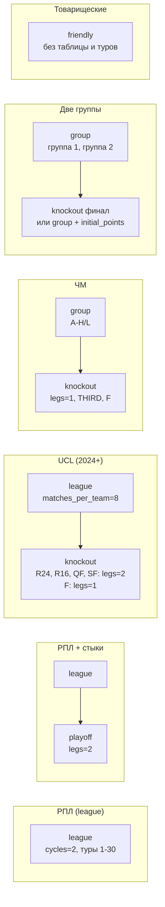

# MatchIQ — форматы соревнований в схеме БД

Как схема ([schema.md](schema.md#1-география-и-соревнования)) покрывает разные форматы турниров. Принцип: **`competitions` говорит, что это за турнир; формат описывают `stages` сезона** (`league` / `group` / `knockout` / `playoff` / `friendly`), а матчи плей-офф собираются в пары `ties` (1 или 2 матча). Один и тот же сезон может состоять из нескольких этапов по порядку (`stages.stage_order`).

## Сводка: формат → структура

| Формат | `competitions.type` | Этапы сезона (`stages.type`) | Туры / раунды | Пары (`ties`) | Таблица |
|--------|--------------------|------------------------------|---------------|---------------|---------|
| Обычный чемпионат с турами (РПЛ) | `league` | `league` (`cycles = 2`) | `rounds.type = matchday`, 1…30 | нет | да |
| Кубок на вылет (только плей-офф) | `cup` | `knockout` | `knockout_round` (R64 … F) | да, `legs = 1` | нет |
| Кубок с группами (Кубок России в макете) | `cup` | `group` → `knockout` | `matchday` в группах, затем `knockout_round` | в плей-офф | в группах |
| Чемпионат + стыковые матчи | `league` | `league` → `playoff` | `matchday`, затем раунд `PO` | да, обычно `legs = 2` | только на `league` |
| Товарищеские матчи | `friendly` | `friendly` | нет (`round_id = NULL`) | нет | нет |
| Лига чемпионов (с 2024/25) | `tournament` | `league` (`matches_per_team = 8`) → `knockout` | 8 `matchday`, затем R24, R16, QF, SF, F | да: `legs = 2`, финал `legs = 1` | на лиговой фазе |
| Лига чемпионов (до 2024/25) | `tournament` | `group` (8 групп) → `knockout` | `matchday` 1–6, затем R16 … F | да: `legs = 2`, финал `legs = 1` | в группах |
| ЧМ | `tournament` | `group` → `knockout` | `matchday` 1–3, затем R16 … F + `THIRD` | да, `legs = 1` | в группах |
| Чемпионат из двух групп | `league` | `group` (2 группы) [→ `knockout` / `group`] | `matchday` в группах | финал групп (опционально) | в каждой группе |
| Турнир только с плей-офф | `cup` / `tournament` | `knockout` | `knockout_round` | да | нет |
| Плей-офф: два матча / один матч | — | `stages.default_legs`, `rounds.legs`, `ties.legs` = 2 / 1 | — | `matches.leg` = 1, 2 | — |

## Ключевые поля формата

| Таблица.поле | Значения | Зачем |
|--------------|----------|-------|
| `competitions.type` | `league` \| `cup` \| `tournament` \| `friendly` | «Жанр» марки; влияет на группировку в UI и на то, какие вкладки показывать |
| `competitions.scope` | `domestic` \| `continental` \| `world` | Страна/регион/мир (табы на главной) |
| `competitions.participant_type` | `club` \| `national` | Допустимые `teams.type` |
| `stages.type` | `league` \| `group` \| `knockout` \| `playoff` \| `friendly` | Формат этапа |
| `stages.cycles` | 1, 2, 4 | Сколько кругов играют `league`/`group` |
| `stages.matches_per_team` | число или NULL | Неполный круг (лиговая фаза UCL) |
| `stages.has_standings` | boolean | Рисовать ли таблицу этапа |
| `stages.default_legs` / `rounds.legs` / `ties.legs` | 1 \| 2 | Матчей в паре плей-офф; раунд переопределяет этап, пара копирует раунд |
| `stages.has_third_place_match` | boolean | Матч за 3-е место (ЧМ) |
| `stages.rules` (jsonb) | очки, тай-брейки, правило выездных голов, доп. время, пенальти, продвижение | Редко меняющиеся правила без новых колонок |
| `stage_teams.stage_group_id` / `initial_points` | — | Группа команды / очки, перенесённые с предыдущего этапа |
| `rounds.type` / `rounds.code` | `matchday` \| `knockout_round`; `R64` `R32` `R24` `R16` `QF` `SF` `THIRD` `F` `PO` | Тур против раунда сетки |
| `ties.*` | см. [schema.md](schema.md#1-география-и-соревнования) | Пара, источники команд, победитель, способ определения, переход в следующую пару |
| `matches.tie_id` / `matches.leg` | NULL у круговых и товарищеских | Принадлежность матча паре и номер матча |

## Рецепты по форматам

### 1. Чемпионат с турами (РПЛ)

```
competition rpl (type=league, scope=domestic, participant_type=club)
 └─ season 2026/27
     └─ stage «Регулярный чемпионат» (league, cycles=2, has_standings=true)
         ├─ rounds: matchday 1…30
         └─ matches: round_id = тур, tie_id = NULL
```

Таблица — `standings` по турам; зоны (ЛЧ, ЛЕ, стыки, вылет) — `standing_zones`. Это единственный сценарий, который сейчас есть в макетах (турнир `id = 1`).

### 2. Кубок

**Чистый кубок (плей-офф):**

```
competition cup (type=cup)
 └─ season 2026/27
     └─ stage «Плей-офф» (knockout, default_legs=1)
         ├─ rounds: R64, R32, R16, QF, SF, F  (knockout_round)
         └─ ties: по одной паре на слот; каждая пара — один матч (matches.leg = 1)
```

**Кубок России из макета (группы → плей-офф):**

```
season 2026/27
 ├─ stage 1 «Групповой этап» (group, cycles=2, has_standings=true)
 │    ├─ stage_groups A, B, C, D;  stage_teams (по 4 команды в группе)
 │    └─ rounds: matchday 1…6
 └─ stage 2 «Плей-офф» (knockout, default_legs=1)
      └─ ties: source_a/source_b = {"type":"group_position","stage_group_id":…,"position":1|2}
```

Страница клуба берёт «группу и мини-таблицу» из `stage_groups` + `standings` этапа `group`; ближайший матч — из `matches` клуба по всем соревнованиям.

### 3. Чемпионат + стыковые матчи

```
season 2026/27
 ├─ stage 1 «Регулярный чемпионат» (league, cycles=2)
 └─ stage 2 «Стыковые матчи» (playoff, default_legs=2, has_standings=false)
      ├─ round «Стыки» (knockout_round, code=PO, legs=2)
      └─ ties: пара 13–14 места РПЛ против 3–4 места ФНЛ (source_a/source_b = standing_position)
```

- Стыковой этап — часть сезона **РПЛ** (матчи пишутся с `competition_id = РПЛ`), в `stage_teams` могут быть команды, играющие в другой лиге (участник ФНЛ) — связь команды с `stage` независима от её «домашней» лиги.
- Результаты стыков **не влияют** на `standings` этапа `league`.

### 4. Товарищеские матчи

```
competition friendly_national (type=friendly, scope=world, participant_type=national)
 └─ season 2026 (календарный год)
     └─ stage «Товарищеские матчи» (friendly, has_standings=false)
         └─ matches: round_id = NULL, tie_id = NULL
```

Для клубных товарищеских — отдельная марка (`participant_type = club`). Без таблицы, без туров, без пар. Вопрос, нужны ли вероятности/picks на товарищеских, — в [open-questions.md](open-questions.md).

### 5. Лига чемпионов

**Новый формат (с 2024/25):**

```
season 2026/27
 ├─ stage 1 «Лиговая фаза» (league, cycles=NULL, matches_per_team=8, has_standings=true)
 │    └─ rounds: matchday 1…8;  одна таблица на 36 команд (stage_group_id = NULL)
 ├─ stage 2 «Плей-офф» (knockout, default_legs=2, has_standings=false)
 │    ├─ R24 (legs=2): пары по standing_position 9–24 (сеяные 9–16 — вторые матчи дома)
 │    ├─ R16 (legs=2): 1–8 места лиговой фазы + победители R24
 │    ├─ QF (legs=2), SF (legs=2)
 │    └─ F (legs=1): одиночный матч, matches.is_neutral_venue = true
```

**Прежний формат (до 2024/25):** stage 1 — `group` (8 групп × 4, `cycles=2`), stage 2 — `knockout` (R16 … F), пары через `group_position`. Для той же марки `competitions.slug = 'ucl'` формат просто описывается другим набором этапов в сезоне.

Зоны в таблице лиговой фазы: 1–8 (прямой выход), 9–24 (плей-офф), 25–36 (вылет) — `standing_zones`.

### 6. Чемпионат мира

```
competition world_cup (type=tournament, scope=world, participant_type=national)
 └─ season 2026
     ├─ stage 1 «Групповой этап» (group, cycles=1)
     │    ├─ stage_groups A…L (по 4 сборные), rounds: matchday 1…3
     └─ stage 2 «Плей-офф» (knockout, default_legs=1, has_third_place_match=true)
          ├─ R32 (если есть), R16, QF, SF
          ├─ THIRD — матч за 3-е место (source_*: tie_loser полуфиналов)
          └─ F — финал; все матчи по одному (legs=1)
```

Ничья в плей-офф решается доп. временем и пенальти: `matches.*_et`, `*_pens`, у пары `ties.decided_by = extra_time | penalties`.

### 7. Чемпионат из двух групп

```
season 2026
 ├─ stage 1 «Групповой этап» (group, cycles=2, has_standings=true)
 │    ├─ stage_groups «Группа 1», «Группа 2» (по N команд; таблица на группу)
 │    └─ rounds: matchday 1…K
 └─ stage 2 — один из вариантов:
      а) «Финал» (knockout, default_legs=1|2): пара победителей групп
      б) «Чемпионская группа» / «Группа вылета» (group, cycles=1|2):
         команды берутся из групп stage 1; очки переносятся через stage_teams.initial_points
```

Варианты а) и б) различаются только набором этапов — отдельных таблиц под «две группы» нет. Если групп нет в этапе, `stage_group_id = NULL` (обычная лига).

### 8. Турнир только с плей-офф

Сезон с единственным `knockout` этапом; `has_standings = false`, вкладка «Таблица» не показывается, вместо неё — сетка пар (`ties.next_tie_id`). Супер-кубок из одного матча — этап `knockout` с одной парой `legs = 1`.

### 9. Плей-офф: один матч или два

| | `legs = 1` (ЧМ, кубки на вылет) | `legs = 2` (UCL, стыки) |
|--|----|----|
| Матчи пары | один, `matches.leg = 1` | два: `leg = 1` (дома у команды A), `leg = 2` |
| Победитель | по счёту; при ничьей — доп. время → пенальти | по сумме голов (`aggregate_a/b`); далее по правилам этапа (`stages.rules`: выездные голы — флаг, доп. время во втором матче, пенальти) |
| `ties.decided_by` | `single_match` / `extra_time` / `penalties` | `aggregate` / `away_goals` / `extra_time` / `penalties` |
| Хозяин поля | по сетке/жеребьёвке (финал — нейтральное поле, `is_neutral_venue`) | хозяин меняется в ответном матче |

Принцип единообразия: **любой матч плей-офф лежит в паре** (`tie_id` не NULL), даже если матч один — тогда не нужно ветвить логику сетки и «кто прошёл дальше».

## Как стадии связаны друг с другом (цепочки)



## Что меняется в приложении

- **Страница турнира:** вкладки строятся из этапов сезона. `league`/`group` → «Таблица» (с переключателем группы, если групп больше одной), «Расписание», «Результаты» по `rounds.type = matchday`; `knockout`/`playoff` → вкладка «Сетка» по `ties`; `friendly` → только «Расписание» / «Результаты» списком.
- **Главная:** группировка по `competitions` без изменений; подпись этапа/тура в строке матча — из `rounds.name` / `stages.name`.
- **Матч:** в шапке — «Группа B · 3-й тур» или «1/8 финала · ответный матч» (`stage_groups.name`, `rounds.name`, `matches.leg`); для ответного — агрегат пары из `ties`.
- **Прогнозы и рынки:** рынок «Пройдёт дальше» (победитель пары) — отдельный `market_types` с `subject = tie` (позже; в MVP не нужен).
- **Коллектор:** сопоставляет через `external_ids` сущности `stage`, `round`, `tie`; для источников без явных этапов создаёт этап по умолчанию (`league`) и определяет плей-офф по названию раунда.
