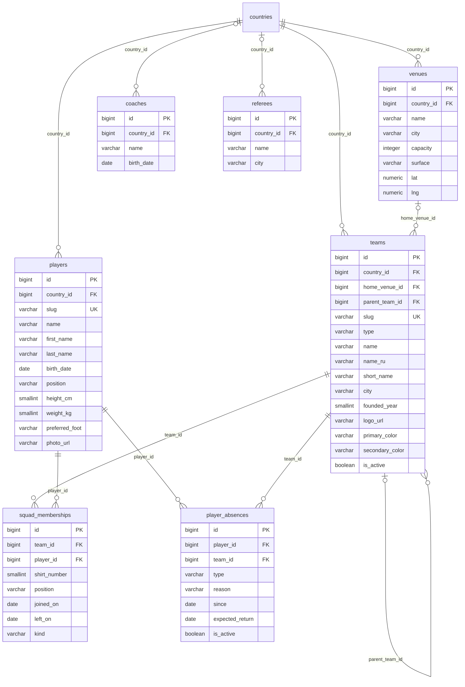
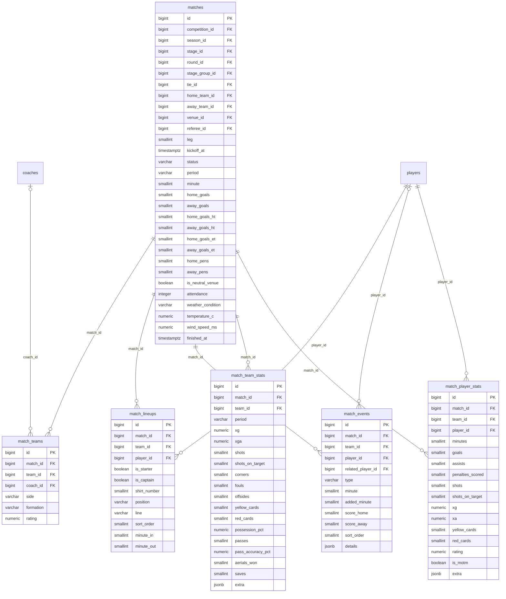
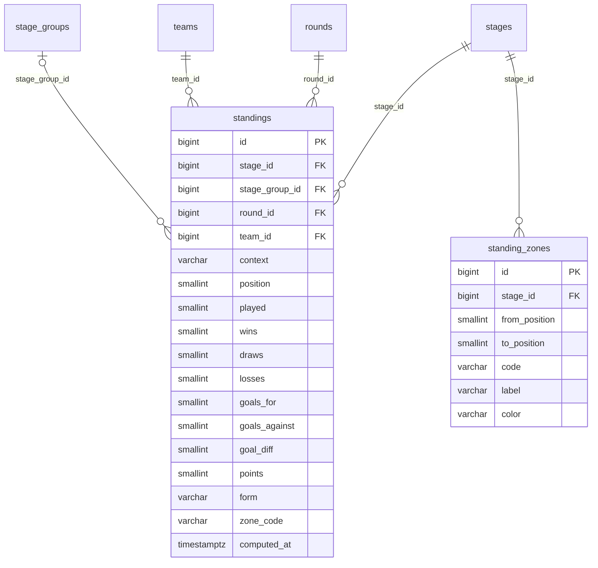
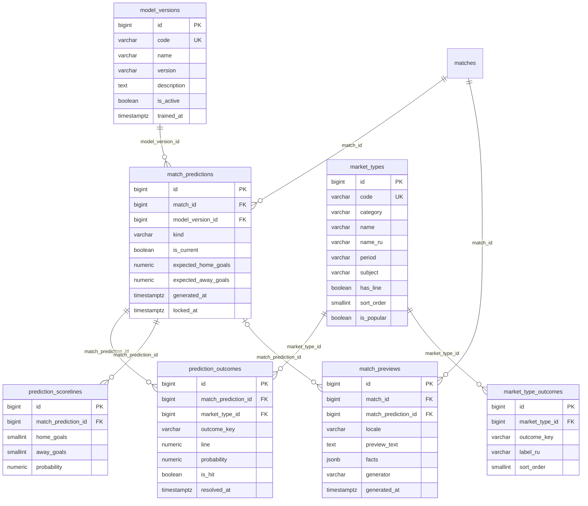
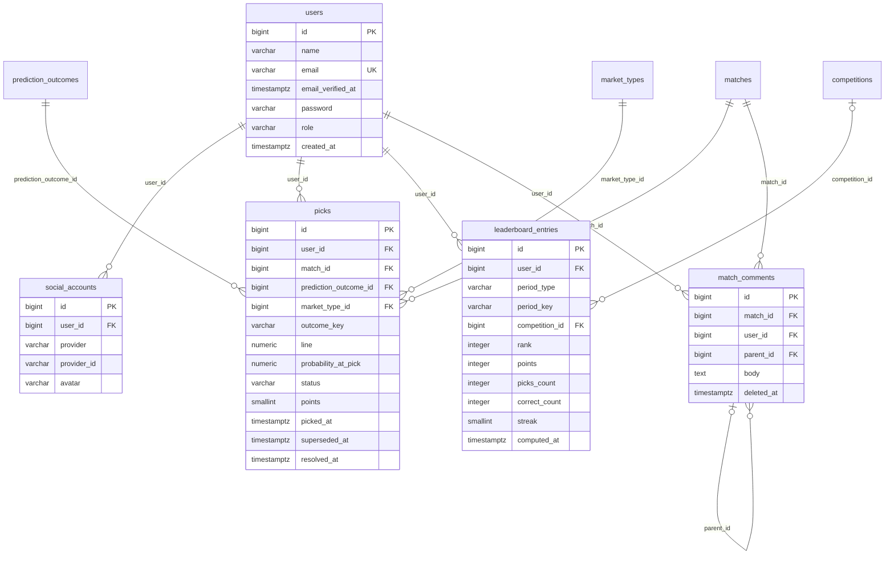
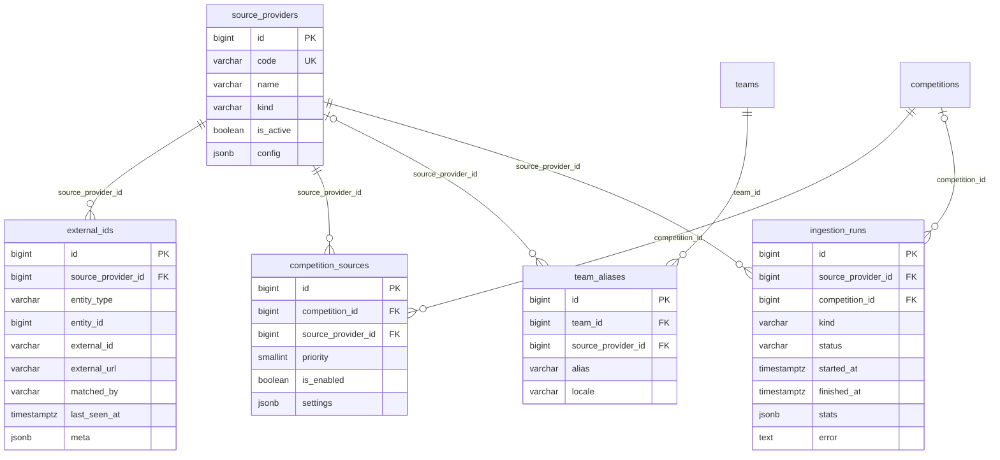

# MatchIQ — схема БД: таблицы по доменам

Принципы и границы MVP — в [README.md](README.md). Открытые вопросы — в [open-questions.md](open-questions.md).

**Соглашения.** `id bigint PK` у каждой таблицы; `created_at` / `updated_at` (`timestamptz`) есть везде и в диаграммах не показаны; перечисления — `varchar` + enum в коде. Тип `numeric` в диаграммах — десятичное число (точность — в тексте). Колонка **MVP**: «да» — нужна для экранов-макетов, «позже» — можно не делать в первой итерации.

Домены:

1. [География и соревнования](#1-география-и-соревнования)
2. [Клубы, стадионы, игроки, составы клубов](#2-клубы-стадионы-игроки-составы-клубов)
3. [Матчи, события, составы, статистика](#3-матчи-события-составы-статистика)
4. [Турнирные таблицы](#4-турнирные-таблицы)
5. [Вероятности, рынки, AI-превью](#5-вероятности-рынки-ai-превью)
6. [Пользователи, picks и рейтинг](#6-users-picks-и-рейтинг)
7. [Источники данных и маппинг](#7-источники-данных-и-маппинг)

---

## 1. География и соревнования

Модель рассчитана на **любой формат соревнования** (круговой чемпионат, кубок, чемпионат + стыки, групповой этап + плей-офф, плей-офф без групп; товарищеские — задел, **вне MVP**; в плей-офф — один матч или два). Формат описывается **не типом соревнования, а цепочкой этапов сезона** (`stages`): у каждого сезона свой набор этапов, поэтому формат может меняться из года в год (UCL до 2024 — 8 групп, с 2024/25 — единая лиговая фаза) без изменения схемы. Готовые «рецепты» по каждому формату — в [formats.md](formats.md).

```mermaid
erDiagram
    countries {
        bigint id PK
        varchar code UK
        varchar kind
        varchar name
        varchar name_ru
        smallint sort_order
    }
    competitions {
        bigint id PK
        bigint country_id FK
        varchar slug UK
        varchar name
        varchar name_ru
        varchar short_name
        varchar type
        varchar scope
        varchar participant_type
        smallint tier
        varchar status
        smallint sort_order
        varchar logo_url
    }
    seasons {
        bigint id PK
        bigint competition_id FK
        varchar label
        varchar slug
        date starts_on
        date ends_on
        boolean is_current
        smallint rounds_total
    }
    stages {
        bigint id PK
        bigint season_id FK
        varchar name
        varchar type
        smallint stage_order
        smallint cycles
        smallint matches_per_team
        boolean has_standings
        smallint default_legs
        boolean has_third_place_match
        jsonb rules
    }
    stage_groups {
        bigint id PK
        bigint stage_id FK
        varchar name
        smallint group_order
    }
    stage_teams {
        bigint id PK
        bigint stage_id FK
        bigint team_id FK
        bigint stage_group_id FK
        smallint seed
        smallint initial_points
    }
    rounds {
        bigint id PK
        bigint stage_id FK
        smallint number
        varchar type
        varchar code
        varchar name
        smallint legs
        date starts_on
        date ends_on
    }
    ties {
        bigint id PK
        bigint stage_id FK
        bigint round_id FK
        smallint tie_number
        bigint team_a_id FK
        bigint team_b_id FK
        jsonb source_a
        jsonb source_b
        smallint legs
        varchar status
        bigint winner_team_id FK
        varchar decided_by
        smallint aggregate_a
        smallint aggregate_b
        smallint penalties_a
        smallint penalties_b
        bigint next_tie_id FK
        varchar next_tie_slot
    }
    countries ||--o{ competitions : "country_id"
    competitions ||--o{ seasons : "competition_id"
    seasons ||--o{ stages : "season_id"
    stages ||--o{ stage_groups : "stage_id"
    stages ||--o{ rounds : "stage_id"
    stages ||--o{ stage_teams : "stage_id"
    stage_groups |o--o{ stage_teams : "stage_group_id"
    stages ||--o{ ties : "stage_id"
    rounds ||--o{ ties : "round_id"
    ties |o--o{ ties : "next_tie_id"
```



(`stage_teams.team_id`, `ties.team_a_id` / `team_b_id` / `winner_team_id` → `teams`, см. домен 2; `matches.tie_id` → `ties`, см. домен 3.)

### Иерархия и роли сущностей

```
competition  — постоянная «марка» (РПЛ, Кубок России, UCL, ЧМ, товарищеские)
 └─ season   — одно издание («2026/27», «2026»)
     └─ stage — этап формата, по порядку (league → playoff; group → knockout …)
         ├─ stage_groups — группы (только если есть группы)
         ├─ stage_teams  — кто участвует (+ группа, посев, перенос очков)
         ├─ rounds       — туры (matchday) или раунды плей-офф (1/8, 1/4, финал)
         └─ ties         — пары плей-офф: 1 матч или 2 (первый + ответный)
             └─ matches  — сами матчи (у плей-офф: tie_id + leg)
```

### Таблицы

| Таблица | MVP | Назначение | Ключевые поля / ограничения |
|---------|-----|------------|------------------------------|
| `countries` | да | Страны (табы на главной) и «псевдо-страны» для международных турниров | `code` — ISO 3166-1 alpha-2 (`RU`, `GB-ENG`) либо `EU` / `WORLD`; `kind`: `country` \| `region` (UCL → «Европа»); `sort_order` порядок табов |
| `competitions` | да | Соревнование как постоянная сущность (РПЛ, ФНЛ, Кубок России, UCL, ЧМ, товарищеские матчи). **Это «турнир» из URL `/tournaments/{id}`**. Описывает «что это за турнир», а не его формат — формат в `stages` | `slug` (`rpl`) UNIQUE; `country_id` NULL для международных; **`type`**: `league` (чемпионат) \| `cup` (кубок) \| `tournament` (многоэтапный: UCL, ЧМ, ЧЕ) \| `friendly` (товарищеские — **вне MVP**, задел); **`scope`**: `domestic` \| `continental` \| `world`; **`participant_type`**: `club` \| `national` (какие `teams.type` допустимы); `tier` — уровень пирамиды; `status`: `live` \| `soon` \| `hidden` (UI «скоро»); `sort_order` — порядок групп в списке матчей; `short_name` — код в чипе |
| `seasons` | да | Издание соревнования («2026/27»; ЧМ — «2026») | UNIQUE (`competition_id`, `slug`); `label` для показа, `slug` вида `2026-27` (параметр `?season=`); `is_current` — не более одного на соревнование (partial unique); `rounds_total` — число туров основного этапа (30) или NULL. У турнира без регулярного сезона (ЧМ, товарищеские) — один сезон на издание/год |
| `stages` | да | **Этап формата сезона.** Определяет, как играют и нужна ли таблица | **`type`**: `league` (круговой турнир без групп: чемпионат, лиговая фаза UCL) \| `group` (групповой этап: несколько групп, таблица на группу) \| `knockout` (плей-офф на вылет: сетка, кубок) \| `playoff` (стыковые/переходные матчи после чемпионата — **этап внутри сезона турнира**, не отдельное соревнование; технически та же сетка пар) \| `friendly` (товарищеские, без туров и таблицы — **вне MVP**, задел); `stage_order` — порядок в сезоне; **`cycles`** — кругов в `league`/`group` (1 — каждый с каждым один раз, 2 — дома и в гостях, 4 — четырёхкруговой); **`matches_per_team`** — для неполного кругового турнира (лиговая фаза UCL = 8; NULL, если полный круг); **`has_standings`** — вести ли таблицу (true для `league`/`group`, false для остальных); **`default_legs`** — матчей в паре для `knockout`/`playoff` (1 или 2); `has_third_place_match`; `rules` jsonb — очки за победу/ничью, тай-брейки, правила определения победителя пары (доп. время, пенальти, правило выездных голов — флагами), **продвижение дальше** (`advancement`: «топ-2 каждой группы → 1/8»). У обычной лиги ровно один stage `league` — он создаётся при заведении сезона |
| `stage_groups` | да | Группы внутри `group`-этапа (Кубок России: A–D; ЧМ: A–H; чемпионат из двух групп: «Группа 1/2») | UNIQUE (`stage_id`, `name`); для `league`/`knockout` групп нет |
| `stage_teams` | да | Участие команды в этапе (+ группа, посев, перенос очков) | UNIQUE (`stage_id`, `team_id`); `stage_group_id` NULL вне групп; `seed` — жеребьёвка/посев; **`initial_points`** — очки, перенесённые с предыдущего этапа (чемпионат делится на «чемпионскую» и «турнир за выживание», очки половинятся). Команда может принадлежать другому соревнованию (стыки: РПЛ ↔ ФНЛ). «16 команд сезона» = distinct `team_id` по этапам сезона. Для плей-офф строки создаются, когда состав пары определён |
| `rounds` | да | **Тур** (`matchday`) для круговых этапов или **раунд плей-офф** (1/8, 1/4, финал) | UNIQUE (`stage_id`, `number`); **`type`**: `matchday` \| `knockout_round`; **`code`**: `R64`, `R32`, `R16`, `QF`, `SF`, `THIRD`, `F`, `PO` (стыки) — для сортировки и локализации; `name` («15-й тур», «1/8 финала»); **`legs`** — матчей в паре в этом раунде (1 или 2), переопределяет `stages.default_legs` (финал UCL — 1 матч при остальных раундах по 2); для `matchday` — NULL; `starts_on`/`ends_on` — даты тура. У `friendly` туров нет (матчи с `round_id = NULL`) |
| `ties` | да | **Пара плей-офф** («противостояние»): один матч или два (первый + ответный). Нужна и для одиночных финалов, чтобы сетка читалась единообразно | `stage_id`, `round_id`, `tie_number` — слот в сетке (UNIQUE `round_id`, `tie_number`); `team_a_id` / `team_b_id` — NULL, пока соперник неизвестен; **`source_a` / `source_b`** jsonb — откуда придёт команда: `{"type":"group_position","stage_group_id":1,"position":1}`, `{"type":"standing_position","stage_id":1,"position":5}` (лиговая фаза UCL), `{"type":"tie_winner","tie_id":42}`, `{"type":"tie_loser","tie_id":42}` (матч за 3-е место); **`legs`** (1 \| 2, копия из `rounds.legs`); `status`: `scheduled` \| `in_progress` \| `finished`; `winner_team_id`; **`decided_by`**: `single_match` \| `aggregate` \| `away_goals` \| `extra_time` \| `penalties` \| `walkover`; `aggregate_a`/`aggregate_b` — суммарный счёт пары (для legs=2); `penalties_a`/`penalties_b` — серия пенальти; **`next_tie_id` + `next_tie_slot` (`a`\|`b`)** — куда проходит победитель (строит сетку для UI без пересчёта правил). Матчи пары — `matches.tie_id` + `matches.leg` (1 или 2); команда A — хозяин первого матча |

**Что даёт UI:** табы стран и чипы лиг — `countries` + `competitions` (`status`, `sort_order`, `short_name`); переключатель сезона на турнире — `seasons`; «Тур 15 из 30» — `rounds` + `seasons.rounds_total`; группы кубка на странице клуба — `stage_groups` + `stage_teams`; сетка плей-офф — `ties` (+ `next_tie_id`); у этапа без таблицы (`has_standings = false`) вкладка «Таблица» не показывается.

**Правило целостности:** `stages.type ∈ {league, group}` → есть `rounds.type = matchday`, нет `ties`; `stages.type ∈ {knockout, playoff}` → матчи всегда с `tie_id`; `friendly` → нет `rounds`/`ties`/`standings`. Проверяется сервисом записи и тестами.

---

## 2. Клубы, стадионы, игроки, составы клубов



| Таблица | MVP | Назначение | Ключевые поля / ограничения |
|---------|-----|------------|------------------------------|
| `teams` | да | Участник матча. На странице называется «клуб» (`/clubs/{id}`), в модели — `teams` (подходит и для сборных) | `type`: `club` \| `national`; `slug`; `short_name` (ЦСКА); `primary_color`/`secondary_color` — цвета команды для шкал/кругов; `home_venue_id` — основной стадион; `parent_team_id` — для дублей/молодёжных («Зенит-2» в ФНЛ); `is_active` |
| `venues` | да | Стадионы | `name`, `city`, `capacity`, `surface`; координаты — для погоды (позже) |
| `players` | да | Игрок как личность (без привязки к клубу) | `position`: `GK` \| `DF` \| `MF` \| `FW` (подписи ВР/ЗЩ/ПЗ/НАП — в UI); `birth_date` (возраст считается); `height_cm`, `weight_kg`, `photo_url` (пусто → инициалы) |
| `squad_memberships` | да | Принадлежность игрока команде во времени («заявка») | период `joined_on`..`left_on` (NULL = действует); `shirt_number`; `kind`: `permanent` \| `loan`; индекс (`team_id`, `left_on`); на странице клуба состав = membership, пересекающийся с датой сезона/матча. Исторические матчи привязываются к игроку через `match_lineups.team_id`, а не через membership |
| `player_absences` | да | «Потери»: травма / дисквалификация / сомнительный | `type`: `injury` \| `suspension` \| `doubtful`; `since`, `expected_return`; `is_active`. Источник — парсер/API; для матча берутся активные записи обеих команд на `kickoff_at` |
| `coaches` | да | Тренеры (в составе матча показывается тренер) | связь с матчем — `match_teams.coach_id` |
| `referees` | да | Судьи (шапка матча, статистика судьи) | связь с матчем — `matches.referee_id`; статистика считается |

---

## 3. Матчи, события, составы, статистика



(`matches.competition_id` → `competitions`, `season_id` → `seasons`, `stage_id` → `stages`, `round_id` → `rounds`, `stage_group_id` → `stage_groups`, `tie_id` → `ties`, `home_team_id`/`away_team_id`/`team_id` → `teams`, `venue_id` → `venues`, `referee_id` → `referees`.)

| Таблица | MVP | Назначение | Ключевые поля / ограничения |
|---------|-----|------------|------------------------------|
| `matches` | да | Матч — ядро домена (`/matches/{id}`) | `kickoff_at timestamptz`; `status`: `scheduled` \| `live` \| `finished` \| `postponed` \| `cancelled` \| `abandoned`; `period`: `first_half` \| `half_time` \| `second_half` \| `extra_time` \| `penalties` (только у live); `minute` — только live; `home_goals`/`away_goals` — счёт после основного времени (и доп. времени, если было), без серии пенальти; `*_ht` — счёт к перерыву; `*_et`, `*_pens` — для кубковых матчей (серия пенальти отдельно); `weather_*` — погода (условие · °C · ветер м/с); `round_id` NULL у товарищеских матчей и стыков без нумерации тура; **`tie_id` + `leg`** — только у матчей плей-офф (`leg` = 1 или 2; одиночный матч — `leg = 1`, пара с `legs = 1`); у круговых этапов и товарищеских — NULL; `stage_group_id` — только на групповом этапе; `is_neutral_venue` — финалы/ЧМ; `CHECK (home_team_id <> away_team_id)`; индексы: (`kickoff_at`), (`stage_id`, `round_id`), (`home_team_id`, `kickoff_at`), (`away_team_id`, `kickoff_at`), (`status`, `kickoff_at`). `competition_id` и `season_id` — **денормализация** от `stage` (ради фильтров главной «лиги + день» и ссылки `match.tournament_id`); согласованность обеспечивает сервис записи/`CHECK` через триггер; индекс (`competition_id`, `kickoff_at`) |
| `match_teams` | да | Данные «стороны» матча: формация, тренер, оценка команды | UNIQUE (`match_id`, `side`) и (`match_id`, `team_id`); `side`: `home` \| `away`; `rating` — оценка команды (только `finished`) |
| `match_lineups` | да | Кто в составе: стартовый и запасные, позиция на поле | UNIQUE (`match_id`, `player_id`); `is_starter`; `position`: `GK/DF/MF/FW`; `line` + `sort_order` — раскладка по линиям для «Расстановки на поле»; `minute_in` (вышел на замену) / `minute_out` (ушёл) — NULL, если нет |
| `match_events` | да | Хроника: голы, ассисты, карточки, замены | `type`: `goal` \| `own_goal` \| `penalty_goal` \| `penalty_missed` \| `yellow` \| `second_yellow` \| `red` \| `substitution` \| `var`; `player_id` — автор / ушедший (при замене); `related_player_id` — ассистент / вышедший; `minute` + `added_minute` (45+2); `score_home`/`score_away` — счёт после гола; `sort_order` внутри минуты; `details` — подтип (удар головой, пенальти, причина карточки). Из событий считаются «голы по минутам», бомбардиры, карточки судьи |
| `match_team_stats` | да | Статистика команды за матч **по периодам** | UNIQUE (`match_id`, `team_id`, `period`); `period`: `full_time` \| `first_half` \| `second_half` (вкладки «Весь матч / 1 тайм / 2 тайм»; по ТЗ «весь матч» = сумма таймов, но хранится явно для источников, отдающих итог отдельно); **ядро — колонками** (xG, xGA, удары, в створ, угловые, фолы, офсайды, карточки, владение, передачи, точность, воздух, сейвы) для агрегатов в SQL; остальное (xG стандартов, блоки, мимо) — в `extra` jsonb |
| `match_player_stats` | да | Статистика игрока за матч | UNIQUE (`match_id`, `player_id`); `rating` (средняя оценка, нужна для «лучших игроков»); `is_motm` — лучший игрок матча (зафиксированный флаг: макс. рейтинг среди обеих команд); `minutes` — для «Гол/90», порогов; остальное — `extra` |

**Решения по домену:**

- Команды-участники в матче всегда известны: «заглушки» сетки (`победитель пары X`, `1-е место группы A`) живут в `ties.source_*`, а матч создаётся, когда обе команды определены (поэтому `home_team_id`/`away_team_id` NOT NULL).
- Каноническая привязка матча — **`stage_id`** (так группы и плей-офф кубка живут в одной таблице); `season_id` и `competition_id` продублированы для быстрых выборок (см. вопрос о денормализации в [open-questions.md](open-questions.md)).
- Live: `status = live`, `minute`, `period` обновляет коллектор; `home_goals/away_goals` — текущий счёт. Статистика live пишется в те же таблицы (режется на момент минуты). Вероятности на live **не пересчитываются** — read-only снимок на kickoff (см. домен 5).
- xG хранится на уровне команды и игрока за матч; построчные удары (shot-level) — **позже** (таблица `match_shots`, см. вопросы).

---

## 4. Турнирные таблицы



**Предложение:** хранить таблицу как **материализованные срезы по турам**, пересчитываемые job'ом при завершении матча, плюс кэш «текущей» таблицы в Redis. Чистый SQL-вид на каждый запрос отвергнут: на странице турнира нужны контексты (все / хозяева / гости), форма в контексте, «срез после N тура» для прошлых сезонов и зоны — это дешевле читать, чем пересчитывать при каждом открытии.

| Таблица | MVP | Назначение | Ключевые поля / ограничения |
|---------|-----|------------|------------------------------|
| `standings` | да | Строка таблицы: команда на этапе (и в группе) после тура `round_id` в контексте | UNIQUE (`stage_id`, `stage_group_id`, `round_id`, `context`, `team_id`); `context`: `overall` \| `home` \| `away`; `form` — строка последних 5 (`WWDLW`, слева старше); `zone_code` — денормализация из `standing_zones` для текущей позиции; «текущая» таблица = срез с максимальным `rounds.number`, где есть сыгранные матчи. `goal_diff` хранится для сортировки/индекса |
| `standing_zones` | да | Зоны таблицы: Лига чемпионов, Лига Европы, стыки, вылет | `from_position`..`to_position`, `code` (`ucl`, `uel`, `relegation_playoff`, `relegation`), `label`, `color`; конфиг на этап; в UI цветная полоса и легенда |

Таблица ведётся только для этапов с `stages.has_standings = true` (`league`, `group`); в плей-офф вместо таблицы — сетка `ties`, у товарищеских таблицы нет. Для `group` строка таблицы привязана к `stage_group_id`; для `league` без групп — NULL. Перенесённые очки (`stage_teams.initial_points`) входят в `points`. Тай-брейки (личные встречи, победы и т.д.) — в `stages.rules`; штрафные очки (если понадобятся) — через поле `points_adjustment` в `stage_teams` (**позже**, см. вопросы). Лидеры игроков/команд (бомбардиры, «лучшие команды») отдельными таблицами **не хранятся**, см. [README](README.md#что-хранится-в-postgresql-а-что-считаем--кэшируем).

---

## 5. Вероятности, рынки, AI-превью



| Таблица | MVP | Назначение | Ключевые поля / ограничения |
|---------|-----|------------|------------------------------|
| `model_versions` | да | Версия модели (Poisson v1 → ML позже) | `code` (`poisson_v1`), `version`, `is_active`; нужно, чтобы сравнивать качество моделей и не терять историю |
| `match_predictions` | да | **Один прогон модели по матчу** — заголовок снимка | `kind`: `pre_match` (обновляется до kickoff) \| `locked` (снимок на kickoff, read-only для live/finished); `is_current` — актуальный для показа (partial unique на матч); `expected_*_goals` — λ Пуассона (ожидаемый тотал на странице); `locked_at`. Старые прогоны **не удаляются**: на них ссылаются picks |
| `market_types` | да | Справочник рынков (карточка «События») | `code`: `result_1x2`, `total_goals`, `btts`, `double_chance`, `handicap`, `halftime_fulltime`, `total_corners`, `total_yellow_cards`, `total_red_cards`, …; `category`: `results` \| `totals` \| `goals` \| `corners` \| `yellows` \| `reds` \| `handicap` (табы Исходы · Тоталы · Голы · Угловые · ЖК · КК); `period`: `full_time` \| `first_half` \| `second_half`; `subject`: `match` \| `home_team` \| `away_team` (позже `tie` — рынок «пройдёт дальше»); `has_line` — рынок с линией (тотал 2.5); `is_popular` — для сортировки «Популярные» |
| `market_type_outcomes` | да | Допустимые исходы рынка (ключ + русская подпись) | `outcome_key`: `home`/`draw`/`away`, `over`/`under`, `yes`/`no`, `1_1`/`1_X`/… (тайм/матч); UNIQUE (`market_type_id`, `outcome_key`); порядок отображения |
| `prediction_outcomes` | да | **Вероятность конкретного исхода рынка в конкретном прогоне** — это то, что показывает UI и на что ставят picks | UNIQUE (`match_prediction_id`, `market_type_id`, `line`, `outcome_key`) (`line` NULL → использовать `COALESCE` / `NULLS NOT DISTINCT`); `probability numeric(5,4)`; группа исходов одного рынка в сумме = 1; `is_hit` / `resolved_at` — «зашло / мимо» после финала (для `finished`); строки **неизменяемы** после записи (новый прогон = новый `match_predictions`) |
| `prediction_scorelines` | да | Сетка точных счетов (0..6 × 0..6) для «возможного счёта» и топ-счетов | UNIQUE (`match_prediction_id`, `home_goals`, `away_goals`); хранить полную сетку или топ-N — решает модель; сумма ≈ 1 |
| `match_previews` | да | AI-превью (2–4 предложения) + факты/инсайты | `locale` (`ru`); `facts` jsonb — список 4–6 пунктов; `generator` — модель/версия промпта; блок скрывается, если записи нет |

**Как это связано с UI:**

- «Прогноз исхода» (П1 · Н · П2 + счёт) → `prediction_outcomes` рынка `result_1x2` + `prediction_scorelines`.
- Рынки в «Событиях» → `prediction_outcomes` с `market_types`; сортировка Лучшие / Худшие — по `probability`; «Популярные» — `market_types.is_popular` + число picks.
- До kickoff — текущий прогон, может обновляться; на kickoff job ставит `kind = locked` — live/finished показывают его (read-only).
- Пустое состояние «Вероятности пока считаются» = у матча нет прогона с `is_current`.

---

## 6. Users, picks и рейтинг



| Таблица | MVP | Назначение | Ключевые поля / ограничения |
|---------|-----|------------|------------------------------|
| `users` | да (есть) | Аккаунты. `name` — ник в рейтинге (может быть кириллицей с пробелами; в URL не используется — только `users.id`) | Таблица уже мигрирована. Возможные добавления: `role` (`user` \| `admin`), `locale`; уникальность ника — [вопрос](open-questions.md) |
| `social_accounts` | да (есть) | Вход через Яндекс / VK | UNIQUE (`provider`, `provider_id`) — уже в миграции |
| `picks` | да | Выбор пользователя: **1 событие на матч**, замена до kickoff | Ссылается на `prediction_outcome_id` — неизменяемую строку снимка; `probability_at_pick` — копия (вероятность модели на момент выбора, нужна для очков и профиля); `market_type_id`/`outcome_key`/`line` — денормализация для быстрых агрегатов («частые события»); `status`: `pending` \| `won` \| `lost` \| `void`; `points` = `round(100 × (1 − probability_at_pick))` при `won`, иначе 0 (формула — `RatingRules::points()`); `superseded_at` — при замене старая строка закрывается, новая создаётся; **partial UNIQUE (`user_id`, `match_id`) WHERE `superseded_at IS NULL`**; `resolved_at` — когда посчитан результат. Принимать pick можно только пока `matches.status = scheduled` и `now() < kickoff_at` (проверка в сервисе) |
| `leaderboard_entries` | да | Материализованные места/очки по окнам | `period_type`: `week` \| `month` \| `season` \| `all_time`; `period_key`: `2026-W47`, `2026-11`, `2026/27`, `all`; `competition_id` NULL = «все лиги» (MVP — только NULL), потом фильтр по лиге без смены схемы; UNIQUE (`period_type`, `period_key`, `competition_id`, `user_id`) (NULL — `NULLS NOT DISTINCT`, PG15+); `rank`, `points`, `picks_count`, `correct_count`, `streak`; `computed_at`. Пересчитывается job'ом после резолва picks |
| `match_comments` | позже | Тред комментариев под матчем | `parent_id` для ответов; `deleted_at` — мягкое удаление; писать только авторизованным |

**Рейтинг:** точка истины — `picks.points` и `picks.resolved_at`. Рейтинг **не обнуляется**; «неделя / месяц / сезон» — окна по времени над одними и теми же picks. Сезон рейтинга (1 авг — 31 июл) вычисляется кодом (`RatingSeason`) и пишется как `period_key`, отдельной таблицы сезонов рейтинга нет. Резолв: job после `matches.status = finished` выставляет `prediction_outcomes.is_hit`, затем `picks.status/points`, затем пересчёт `leaderboard_entries`. История **мест** во времени хранится только в той мере, в какой окна дают срезы (`period_key`); графика рейтинга в MVP нет.

---

## 7. Источники данных и маппинг



| Таблица | MVP | Назначение | Ключевые поля / ограничения |
|---------|-----|------------|------------------------------|
| `source_providers` | да | Источники: парсер сайта, платный API, ручной ввод | `code` (`scraper_xxx`, `api_xxx`, `manual`), `kind`: `scraper` \| `api` \| `manual`; `config` jsonb — базовый URL, лимиты, **без секретов** (секреты — в env) |
| `competition_sources` | да | Какой провайдер питает какую лигу и в каком приоритете | UNIQUE (`competition_id`, `source_provider_id`); `priority` (меньше — приоритетнее при конфликте), `is_enabled`; `settings` — внешний код лиги, частота опроса. Включение лиги = строка тут + `competitions.status = 'live'` |
| `external_ids` | да | **Единый маппинг сущностей:** (провайдер, тип сущности, внешний id) → наш `id` | UNIQUE (`source_provider_id`, `entity_type`, `external_id`); индекс (`entity_type`, `entity_id`); `entity_type`: `country` \| `competition` \| `season` \| `stage` \| `round` \| `tie` \| `team` \| `venue` \| `player` \| `coach` \| `referee` \| `match` \| `market_type`; `matched_by`: `auto` \| `manual` \| `alias`; `last_seen_at` — для чистки; `meta` — сырой признак для отладки. Полиморфная связь без FK: целостность проверяет приложение (morph map); при смене источника для той же сущности появляется вторая строка с другим `source_provider_id` |
| `team_aliases` | да | Названия команд для автосопоставления (кириллица/латиница, «Spartak Moscow» / «Спартак») | UNIQUE (`team_id`, `alias`, `source_provider_id`) (провайдер NULL — общий алиас); нормализованная форма (lower, без пробелов/диакритики) считается в коде |
| `ingestion_runs` | да | Журнал запусков коллектора | `kind`: `schedule` \| `match_stats` \| `lineups` \| `live`; `status`: `running` \| `ok` \| `failed` \| `partial`; `stats` jsonb (создано/обновлено/пропущено); `error`. Для мониторинга и отката, без бизнес-логики |

**Поток записи:** коллектор получает сырые данные → ищет `external_ids` (нет — пробует `team_aliases` / ручной разбор очереди несматченных) → upsert в доменные таблицы по нашему id → обновляет `last_seen_at`. Хранение сырых payload'ов (`raw_payloads`) — **позже**, лучше вне основной БД (S3/объектное хранилище) или с retention.

---

## Сводка таблиц (для миграций)

| Домен | Таблицы |
|-------|---------|
| География / соревнования | `countries`, `competitions`, `seasons`, `stages`, `stage_groups`, `stage_teams`, `rounds`, `ties` |
| Клубы / люди | `teams`, `venues`, `players`, `squad_memberships`, `player_absences`, `coaches`, `referees` |
| Матчи | `matches`, `match_teams`, `match_lineups`, `match_events`, `match_team_stats`, `match_player_stats` |
| Таблицы | `standings`, `standing_zones` |
| Прогнозы | `model_versions`, `match_predictions`, `market_types`, `market_type_outcomes`, `prediction_outcomes`, `prediction_scorelines`, `match_previews` |
| Пользователи | `users`*, `social_accounts`*, `picks`, `leaderboard_entries`, `match_comments` (позже) |
| Источники | `source_providers`, `competition_sources`, `external_ids`, `team_aliases`, `ingestion_runs` |

\* уже мигрированы. Итого новых таблиц: **38** (из них «позже» — `match_comments`).
